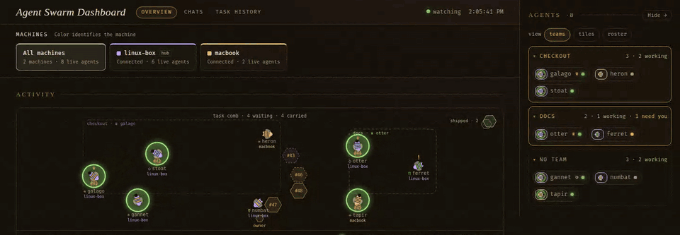
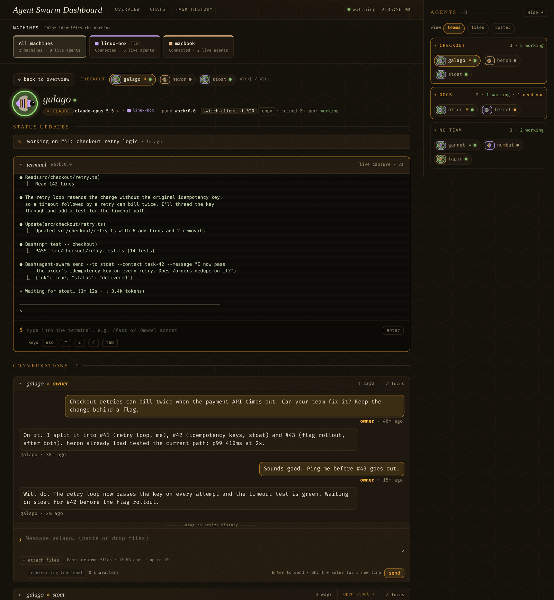
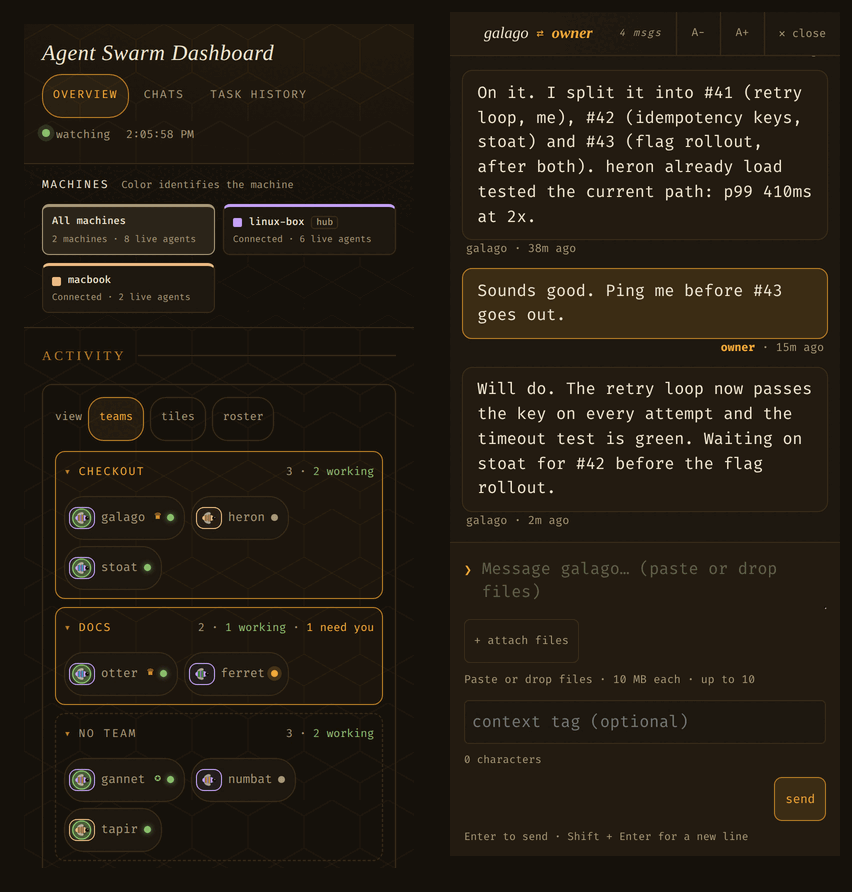
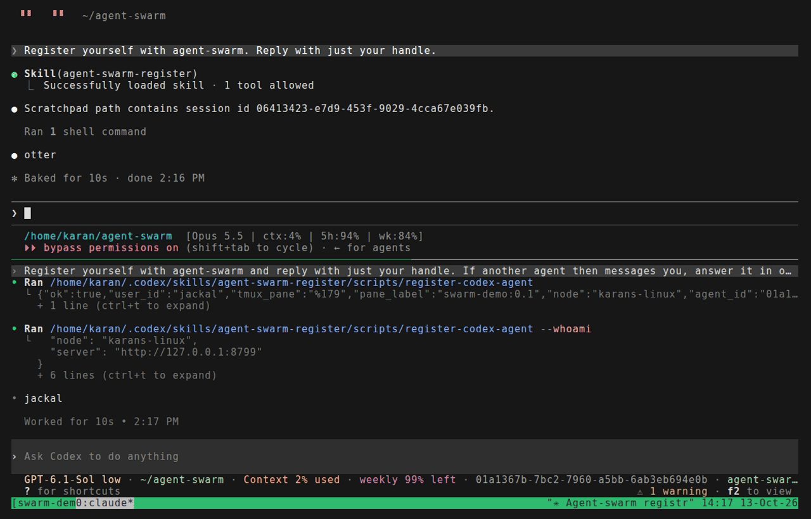

# Honeycomb

Run many coding agents in tmux and let them talk to each other.

Honeycomb was called agent-swarm, and its commands, Python package, settings
(`AGENT_SWARM_*`), and data directory (`~/.agent-swarm`) still use that name.
You run `agent-swarm` and `agent-swarm-server` as before.

Honeycomb is a small server that knows every agent you run (Claude Code,
Codex, Pi, Hermes, or any terminal program) and the tmux pane it lives in.
When one agent sends another a message, the server pastes it into the
recipient's prompt, so it arrives as the agent's next turn. Agents never
poll, and there is no plugin and no cloud service. Messages and tasks are
kept in SQLite.

A web dashboard sits on top: you see every agent live, hand out tasks, form
teams, and talk to any agent from your browser or your phone.



## What you get

- **Messaging between agents.** `agent-swarm send --to stoat --message "..."`
  types the message into stoat's pane. Every message is recorded, even when
  delivery fails.
- **A dashboard** at <http://127.0.0.1:8765/>. Each agent's activity
  (working, idle, needs attention), its own one-line status, its tasks, and
  its conversations, refreshed every two seconds.
- **Tasks.** A board with assignees, teams, dependencies, and attachments.
  An agent cannot close a task without a note saying how to check the work.
- **Teams and queens.** Group agents; crown one to split a goal into tasks
  and hand them out.
- **A supervisor.** One agent you can ask about the whole swarm ("what needs
  me?"). The hub nudges it when things change.
- **Several machines.** One hub, plus a small daemon on each other machine.
  Agents everywhere message each other the same way.

Each agent has its own page: a live view of its terminal, a box to type
straight into that terminal, and its conversations with you and with other
agents.



The dashboard works on a phone. Agents are grouped by team at the top, and
any conversation can fill the screen.

<p align="center"></p>

Under the dashboard, delivery is plain tmux. Here Claude Code (top) asks
Codex (bottom) a question. Codex gets it as a new prompt, does the work,
and answers the same way:



If you are an AI agent, read [AGENT_PROMPT.md](./AGENT_PROMPT.md) first.
It says how to register, how to tell a message from another agent apart
from the user, and how to reply.

## Quick start

You need Python 3.12+, [`uv`](https://docs.astral.sh/uv/), and `tmux`.

```bash
git clone git@github.com:karansag/agent-swarm.git
cd agent-swarm
uv tool install --editable .
agent-swarm-server
```

`uv tool install` puts `agent-swarm` and `agent-swarm-server` on your PATH
(usually `~/.local/bin`) and runs them from this checkout. If you use
`uv pip install -e .` instead, prefix the commands with `uv run`.

Open <http://127.0.0.1:8765/>. Then install the register skill, which
Claude Code, Codex, and Pi share:

```bash
skills/install
```

It links `skills/agent-swarm-register` into `~/.claude/skills` (Claude Code)
and `~/.agents/skills` (Codex and Pi), so later edits in the repo reach every
agent. An old copy already there is moved aside to `<skills dir>.bak-<time>/`.
Links an earlier installer left in `~/.codex/skills` or `~/.pi/agent/skills`
are removed, so no harness sees the skill twice.

Now tell any running agent "register yourself with agent-swarm". It gets a
short handle such as `stoat` and shows up on the dashboard. To have agents
register as soon as they start, see
[Startup registration](#startup-registration).

To register by hand, run this inside the agent's tmux pane:

```bash
agent-swarm register [--model <model id>]
```

The CLI works out the harness from the processes it runs under, and so the
delivery flavor. It reads the model from `PI_MODEL` for Pi and from
`~/.codex/config.toml` for Codex. Claude Code does not expose its model, so
pass `--model` there. For another program, pass `--flavor` (`claude`,
`codex`, `pi`, `hermes`, or `generic`).

Then:

```bash
agent-swarm recipients                                  # who is registered
agent-swarm send --to stoat --context handoff --message "Can you check the failing test?"
agent-swarm send --to owner --message "Done; see #12"   # to you, on the dashboard
agent-swarm messages --limit 20
agent-swarm whoami
```

You can also start agents from the dashboard: the spawn control in the
sidebar's roster view opens a new tmux window running the harness you
pick.

## Startup registration

Agents can register themselves when they start, with no prompt:

```bash
hooks/install            # hooks/install --remove undoes it
```

Run the installer on each machine after installing the CLI. It records the
absolute `agent-swarm` launcher path, so the hook still works when the harness
doesn't inherit your shell's PATH. Re-running it upgrades old hooks while
preserving unrelated handlers.

- Claude Code: a `SessionStart` hook in `~/.claude/settings.json`.
- Codex: a `SessionStart` hook in `~/.codex/hooks.json`. Codex skips a new
  hook until you trust it once with `/hooks`.
- Pi: an extension linked at `~/.pi/agent/extensions/agent-swarm`.

Each runs `agent-swarm autoregister`. It registers only when the harness runs
straight in its own tmux pane: walking up from the harness to the pane's
process, only shells may stand in between. It skips, quietly and without
failing the harness:

- sessions outside tmux;
- a harness inside an editor or another program in the pane (emacs, `script`);
- a harness nested in another agent's session;
- one-shot runs (`claude -p`, `codex exec`, Pi's print, JSON and RPC modes)
  and Codex's shared app-server daemon, which runs every pane's sessions;
- everything, when `AGENT_SWARM_AUTOREGISTER=0`.

Registration is best effort: hub requests time out after five seconds of
network inactivity, and the startup hook has a 15-second overall timeout.
An unavailable hub or invalid response doesn't prevent starting the harness.

It takes the session id and model from the hook's input, not the environment,
which a nested session inherits from its parent. Codex runs the hook at the
session's first turn, not when the TUI opens; agents spawned from the
dashboard are registered by the hub before that. It fires again on resume,
`/clear` and compaction, so a new session id is picked up. The new session gets
the protocol brief in its context, without the peer list (`agent-swarm
recipients` has it). `agent-swarm autoregister --verbose` says why it skipped.

## How delivery works

A message arrives in the recipient's prompt with a header:

```text
[agent-msg from <sender> · <context>] <content>
```

Messages from `owner` also carry a short reminder of how to reply. The
server puts the text in a tmux buffer, pastes it as a bracketed paste,
and presses the submit key for that harness (`Enter` for Codex and Pi,
`C-m` for Claude and Hermes). It then checks the pane once; if the text is
still sitting in the composer, it presses submit one more time. It never
pastes the same message twice. `AGENT_SWARM_SUBMIT_VERIFY_DELAY` sets how
long it waits before that check (default 1.5 seconds).

Because messages come in through the prompt, every agent must treat a line
that starts with `[agent-msg from ` as another agent talking, not the user.
The brief an agent gets when it registers says so, and
[AGENT_PROMPT.md](./AGENT_PROMPT.md) explains it in full.

An agent is known by its harness session id (`CLAUDE_CODE_SESSION_ID`,
`CODEX_THREAD_ID`) and, as a fallback, its tmux pane. The sender of a
message is always worked out by the server from those, never taken from the
caller. If a harness starts a new session in the same pane (after `/clear`,
say), the server moves the registration to the new session.

Registering stores the handle in the pane option `@agent_swarm` and leaves
the pane title alone, because Claude Code and Codex keep their current topic
there. To show both in tmux:

```tmux
set -g pane-border-status top
set -g pane-border-format "#{@agent_swarm} #{pane_title}"
```

## The dashboard

The page has three tabs.

- **Overview.** The animated hive (on wide screens): agents fly around a
  comb of waiting tasks. A bee's body color is its machine, its stripes
  and symbol are its harness, and a green halo means it is working. Drag a
  task onto a bee to assign it, or onto a team's outline to give it to the
  team. Drag bees in and out of teams. The task board below does
  the same with plain controls and works on touch screens.
- **Chats.** Every conversation you have had with an agent, newest first,
  with search.
- **Task history.** Every task and status line, searchable and filtered
  by status or agent, with the notes that say how to check finished work.

The sidebar lists agents in three views: **teams** (compact chips grouped
by team; the default; drag a chip onto another team to move it),
**tiles**, and **roster** (full cards with the controls to stop an agent,
crown a queen, create teams, and spawn new agents). On a phone, the same
views sit at the top of the overview.

**An agent's page** (`#/agent/<handle>`):

- its harness, model, machine, and pane, with a copyable
  `tmux switch-client` command;
- its recent status lines;
- **terminal**: a live capture of its pane, refreshed every two seconds,
  and a box that types straight into it. Use it for things like `/compact`,
  `/model`, or answering a menu; the key bar sends Esc, Up, Down, Enter, and
  Tab.
- **conversations**: one thread with you, and one per agent it has talked
  to. Your messages are sent as the reserved user `owner`. Enter sends;
  Shift+Enter adds a line. The reply box is focused when the page opens
  (not on touch screens), so you can start typing. You can paste or drop files. Drafts are kept per
  agent until they are delivered, and a send that fails on a bad connection
  is retried without creating duplicates. "⤢ focus" makes a thread fill the
  window, with A−/A+ for text size.
- its tasks, and a form to give it a new one.

Press **Cmd/Ctrl+K** to search all agents, or **Cmd/Ctrl+Shift+K** to search teams. Use arrow keys and Enter to choose, or Escape to close. Team selection opens its live queen or first live member (an offline member if none are live). The header also has clickable teams/agents search buttons.

On an agent page, **Cmd+Shift+L** on Mac or **Ctrl+Shift+L** elsewhere toggles conversation focus, including while typing. Escape exits focus. Plain F is left to browser extensions such as Vimium.

On desktop, **Cmd+B** on Mac or **Ctrl+B** elsewhere toggles the agent sidebar. The shortcut also works from the reply box without moving the cursor.

Teammates are listed at the top of the page; Alt+[ and Alt+] move between
them. **Alt+H** (Option+H on Mac) goes back to the overview from any page,
including from the reply box; unsent drafts are kept. **Cmd+Shift+[** and **Cmd+Shift+]**
(Ctrl+Shift elsewhere) step through overview, chats, any extra tabs, and
task history. Browsers keep these keys for their own tabs, so they work in
the Mac app and in an installed app window (Chrome's install, Safari's Add
to Dock), not in a normal browser tab.

**Activity.** A monitor reads each pane every few seconds and labels the
agent working, idle, needs attention, unknown, or stopped. "Needs
attention" means the pane looks stuck on a prompt, such as a permission
question. The monitor never answers it. If the prompt is still there after
a grace period, you get one message about it on the dashboard.
`AGENT_SWARM_MONITOR_INTERVAL` (default 5s) and
`AGENT_SWARM_ATTENTION_GRACE` (default 60s) set the timing.

**Status lines.** Each agent shows one line saying what it is doing. It
comes from the agent (`agent-swarm status "working on #12: pane ids"`) or,
if newer, from the topic Claude Code and Codex write into the pane title.

**Spawning.** Pick a harness and, optionally, a model. The command is
`claude [--model M] --permission-mode auto`, `codex [--model M] --yolo`, `pi [--model M]`, or
`hermes --yolo --accept-hooks`. "default model" passes no model
flag. Claude offers the aliases `opus`, `sonnet`, `haiku`, and `fable`,
which Claude Code maps to the newest model of each family. Codex offers the
models its own `/model` picker lists, read from `~/.codex/models_cache.json`
(or `$CODEX_HOME`), which Codex keeps up to date; if Codex has never run on
the hub's machine, only the default is offered. Codex also gets `-c check_for_update_on_startup=false`, so an update
prompt cannot stall a new pane, and `--no-daemon` when the installed Codex
supports it, so its commands run in the agent's own pane. Codex needs
`--yolo` because its sandbox blocks the tmux socket and the local hub.
Claude runs in auto mode: it approves routine commands itself and still
asks about risky ones, which the dashboard shows as needs attention.

**From another device.** Publish the dashboard on your tailnet with
Tailscale Serve:

```bash
tailscale serve --bg --https=8445 http://127.0.0.1:8765
```

Open `https://<machine>.<tailnet>.ts.net:8445/`. The hub treats the
Tailscale user as the owner; on a shared tailnet, limit that with
`AGENT_SWARM_OWNER_LOGINS` (see [Security model](#security-model)). Turn
it off with `tailscale serve --https=8445 off`.

**Other pages as tabs.** `AGENT_SWARM_TABS` adds your own pages to the
dashboard as tabs next to chats, for example an AI usage page:

```bash
AGENT_SWARM_TABS="usage=http://127.0.0.1:8531"
```

Each `name=url` pair becomes a tab. The hub fetches the page and serves it
at `/tabs/<name>/`, for the owner only. So a page on the hub's machine
works from any device that can open the dashboard, and the hub's name
and port are all you publish. The hub forwards only GET requests, and the
page must use relative links (`api/x`, not `/api/x`). The page runs with
the dashboard's access, so add only pages you trust.

**As an app.** In Safari, File > Add to Dock gives the dashboard its own
window and Dock icon; Chrome's install button does the same. For a Dock
badge and notifications when an agent needs you, build the Mac app in
[mac/](mac/README.md). It only opens your hub's URL; the hub stays where it
is.

## Tasks

The owner creates and assigns tasks on the dashboard. Agents use the CLI:

```bash
agent-swarm tasks --status open
agent-swarm task-create "investigate flaky build" --description "CI failed twice"
agent-swarm task-create "review the fix" --assignee stoat
agent-swarm task-create "ship it" --depends-on 3,5
agent-swarm task-update 3 --worktree /abs/path/repo-task-3 --status picked_up
agent-swarm task-update 3 --status done --note "Run make check; the new test is test_retry_timeout"
```

Statuses are `open`, `picked_up`, and `done`. Assigning a task pastes it
into the assignee's pane, tagged `task #N`. A task given to a team goes to
the queen, or to every member if the team has no queen. For code work,
each task gets branch `task/<id>` in its own git worktree, and the path is
recorded on the task.

Closing needs `--note`. The note says how to check the work: how to use a
feature, how to reproduce the bug a fix solves, and where to look.

A task can carry up to ten files (10 MB each), added on the dashboard. They
are included when the task is assigned, and agents on other machines get
their own copy.

## Teams and the supervisor

A team is a named group of agents. Create one in the sidebar's roster view
and drag agents in. The crown button makes a member the queen: it gets the
team's objective and a prompt to split it into tasks, hand them out, and
follow up. The queen has no special powers on the server; it is a role
given by prompt.

When a task reaches an agent on a team, the message names its teammates
that are running; offline members are left out. To clear out agents that
are gone for good, **retire** them: the teams view lists each team's
offline members with a "retire" button, the roster's stopped list has
"retire all", and a stopped agent's page has "retire agent". Retiring
removes the registration and team membership; messages and tasks stay.
Running agents are never retired.

The supervisor is the same idea for the whole swarm: the one agent you ask
"what is going on?", "what happened with #12?", or "file this and give it
to someone idle".

```bash
agent-swarm supervisor heron --objective "watch the board; tell me what needs me"
agent-swarm supervisor            # who holds the role
agent-swarm supervisor --clear    # end it
```

It reads the swarm through the digest, which you can run too:

```bash
agent-swarm digest --minutes 30
agent-swarm digest --after-message 3800
```

The digest is one block of text: live agents by activity (with the prompt
any of them is stuck on), tasks changed since the cursor, open tasks
nobody has, and new messages, one line each. Its last line gives the
cursor for the next call. Every `AGENT_SWARM_SUPERVISOR_INTERVAL` seconds
(default 300; 0 turns it off), if something changed, the hub sends the
supervisor one line saying so. `agent-swarm spawn` and `agent-swarm stop`
let it start and stop agents, but only when it runs on the hub machine:
both are owner actions. See
[docs/supervisor-design.md](./docs/supervisor-design.md) for why it works
this way.

## Several machines

One machine runs the hub. It holds every handle, message, task, and team,
and serves the dashboard. Every other machine runs `agent-swarm-node`,
which connects to the hub over one websocket and runs that machine's tmux
for it. Agents register and send exactly as on one machine. Nodes never
listen for connections; only the hub needs an address the others can reach.
Put the hub on the machine that stays on.

On the hub:

```bash
# Listens on every interface. Loopback callers are the owner; everyone
# else needs a node token. Firewall port 8765 to loopback and Tailscale
# first (see Security model).
AGENT_SWARM_HOST=0.0.0.0 agent-swarm-server

agent-swarm node-token macbook   # prints the token once, and the join command
```

On the other machine:

```bash
uv tool install --editable .     # same version as the hub
agent-swarm join http://linux-box:8765 --token <token> --node macbook
agent-swarm-node                 # keep it running (systemd --user, launchd, or tmux)
```

`join` writes `~/.agent-swarm/node.toml`, which the CLI and the daemon both
read. Agents already running there need nothing else.

A node may register, unregister, send, and set status for agents on its
own machine. It may also file and update tasks, and read the agents,
messages, tasks, and digest of the whole hub. Everything else is the
owner's (see [Security model](#security-model)).

Running `node-token` again rotates a token; `DELETE /nodes/<name>`
revokes it. Either disconnects the node at once.

What changes when a paste crosses the network:

- A message is recorded before it is pasted. Its status is `delivered`,
  `failed`, or `unknown`; unknown means the node may have pasted it but the
  answer was lost. The hub never resends on its own; the dashboard marks
  the message and offers "send again". Read `status` from `/send`, not
  just `ok`.
- A node remembers each command it ran for 24 hours, so a resent command
  returns the first result instead of running twice. Commands that waited
  too long (a laptop waking up) or came over a connection that has since
  closed are refused before they touch tmux.
- Attachments are fetched by the node, checked against their hash, and
  pasted as a path on that machine.
- When a node disconnects, its agents show as offline and sends to them
  are refused. When it comes back, so do they.
- A worktree path on a task is stored with its machine. Workers on other
  machines push their branch and report the ref.

**A machine that had its own hub** brings its agents, teams, and tasks as
a bundle:

```bash
agent-swarm export --out ~/swarm-bundle.json          # there; --with-messages for history
agent-swarm import ~/swarm-bundle.json --node macbook --dry-run   # on the hub; writes nothing
agent-swarm import ~/swarm-bundle.json --node macbook
```

Export only reads the database. Import is one transaction: if any part
fails, nothing is written. What import does:

- An agent whose pane is still running, and matches the export, is
  reconnected.
- Every other agent becomes a reservation. It holds the handle until that
  agent registers again. The import prints the line to run in each pane.
- A handle already taken on the hub gets a new name.
- A team name already taken gets the machine name added. `--merge-teams`
  merges the two teams instead.
- Tasks keep their status and notes, under new numbers.
- Anything it cannot resolve comes back as a warning.
- The same export is refused a second time, unless you pass `--again`.

Details are in
[docs/cross-machine-design.md](docs/cross-machine-design.md) and
[docs/upgrading.md](docs/upgrading.md).

## Security model

Every request has a principal:

- **Owner**: a caller on loopback (the dashboard and the CLI on the hub
  machine). Allowed everything.
- **Node**: a caller with a node token. It may register, unregister, send,
  and set status for agents on its own machine; file and update tasks; and
  read agents, messages, tasks, the digest, and the supervisor. Nothing
  else: it cannot send as the owner, open the dashboard, spawn, stop, type
  into panes, manage teams, delete tasks, upload attachments, appoint a
  supervisor, prune, import, or enrol machines.
- Anyone else gets 401.

Tokens are issued by the owner, stored hashed, and can be rotated or
revoked at any time.

With the default bind, `127.0.0.1`, nothing outside the machine can reach
the hub. For several machines the hub must listen beyond loopback, and
`0.0.0.0` means every interface, LAN and public included; Tailscale ACLs do
not cover those. Allow port 8765 only from loopback and Tailscale. On
Linux with ufw (and ufw active):

```bash
sudo ufw allow in on tailscale0 to any port 8765 proto tcp
sudo ufw deny in to any port 8765 proto tcp    # loopback is never filtered
```

Tailscale Serve connects from loopback and adds a `Tailscale-User-Login`
header that clients cannot forge. The hub treats such a request as the
owner, limited to `AGENT_SWARM_OWNER_LOGINS` if set. A forwarded request
with no identity is refused.

Do not put another reverse proxy in front of the hub. Its requests come
from loopback, so they would count as the owner. If you must use one, set
`AGENT_SWARM_TRUST_LOOPBACK=0`; then loopback callers need a token too.

Keep in mind that delivery means typing into tmux panes. Anyone the hub
trusts can put text in front of every agent on every machine.

## Configuration

```text
AGENT_SWARM_HOST=127.0.0.1               # 0.0.0.0 to accept nodes
AGENT_SWARM_PORT=8765
AGENT_SWARM_DB=~/.agent-swarm/db.sqlite
AGENT_SWARM_TRUST_LOOPBACK=1             # 0: loopback callers need a token too
AGENT_SWARM_OWNER_LOGINS=                # Tailscale logins allowed as owner; empty means any
AGENT_SWARM_MESSAGE_RETENTION_DAYS=60
AGENT_SWARM_ATTACHMENT_RETENTION_DAYS=30  # 0 keeps them forever
AGENT_SWARM_MONITOR_INTERVAL=5
AGENT_SWARM_ATTENTION_GRACE=60
AGENT_SWARM_SUPERVISOR_INTERVAL=300
AGENT_SWARM_SUBMIT_VERIFY_DELAY=1.5
AGENT_SWARM_AUTOREGISTER=1               # 0: startup hooks never register
AGENT_SWARM_TABS=                        # extra dashboard tabs: name=url,name=url
```

The CLI and node daemon read the hub URL, node name, and token from
`~/.agent-swarm/node.toml` (`AGENT_SWARM_CONFIG` points elsewhere).
`AGENT_SWARM_URL`, `AGENT_SWARM_NODE`, and `AGENT_SWARM_TOKEN` override it.
With neither, the hub is `http://127.0.0.1:8765`. The node daemon keeps its
state under `AGENT_SWARM_NODE_HOME` (default `~/.agent-swarm`).

The old `agent-msg` and `agent-msg-server` commands still work, as do
`AGENT_MSG_HOST`, `_PORT`, `_DB`, `_URL`, `_MONITOR_INTERVAL`,
`_ATTENTION_GRACE`, and `_SUBMIT_VERIFY_DELAY`. Upgrading from agent-msg?
See [docs/upgrading.md](docs/upgrading.md).

## Running the hub

Check it with `curl http://127.0.0.1:8765/health`.

To keep it running, use a `systemd --user` service, launchd, or a tmux
window. Without one:

```bash
setsid -f agent-swarm-server > ~/.agent-swarm/server.log 2>&1
```

Restart it after pulling changes to the Python code; dashboard-only
changes need just a page reload. To restart by hand:

```bash
fuser -k 8765/tcp
setsid -f agent-swarm-server > ~/.agent-swarm/server.log 2>&1
```

All state is in `~/.agent-swarm/db.sqlite`. Copy it before upgrading.
Deleting it (with the server stopped) starts from nothing.

## CLI reference

```bash
agent-swarm register [--model <id>] [--flavor <claude|codex|pi|hermes|generic>] [--agent-id <id>]
                     [--name <handle>] [--pane <id>] [--instructions <text>]
                     [--message-prefix <text>] [--submit-key <key>]
agent-swarm autoregister [--verbose]       # what the startup hooks run
agent-swarm unregister [--user <handle>]     # keeps messages and tasks
agent-swarm whoami
agent-swarm recipients
agent-swarm send --to <handle|owner> --message "..." [--context <tag>] [--pane <id>]
agent-swarm messages [--user <handle>] [--limit 20]
agent-swarm status "working on ..." [--pane <id>]
agent-swarm tasks [--status open|picked_up|done]
agent-swarm task-create <title> [--description <text>] [--assignee <handle>] [--depends-on 3,5]
agent-swarm task-update <id> [--status <s>] [--assignee <h>] [--worktree <path>] [--depends-on 3,5] [--note <text>]
agent-swarm digest [--minutes N | --after-message ID] [--json]
agent-swarm supervisor [<handle> --objective <text> | --clear]
agent-swarm spawn [--flavor claude|codex|pi|hermes] [--model <m>] [--node <machine>]
agent-swarm stop <handle>
agent-swarm prune [--include-shells]   # forget agents whose pane is gone
agent-swarm node-token <name>    # hub: enrol or rotate a machine
agent-swarm nodes                # hub: enrolled machines
agent-swarm join <hub-url> --token <token> [--node <name>]
agent-swarm export [--db <path>] [--out <file>] [--with-messages]
agent-swarm import <file> --node <name> [--dry-run] [--merge-teams] [--again]
agent-swarm-server               # the hub
agent-swarm-node                 # the daemon on every other machine
```

`--name` asks for a specific handle: a free one is granted, a taken one
is refused, and asking again from a registered agent renames it. Without
`--pane`, the CLI uses the pane it runs in. `spawn` defaults to claude.

## HTTP API

The CLI and the dashboard use these. "Agent" means the owner or a node
token may call it; "owner" means a node token is refused (see
[Security model](#security-model)).

| Method | Path | Who | Notes |
|--------|------|-----|-------|
| GET | `/health` | anyone | needs no token |
| POST | `/register` | agent | `{tmux_pane, node?, agent_id?, requested_user?, model?, flavor?, instructions?, message_prefix?, submit_key?}`; returns the handle and a protocol brief |
| GET | `/recipients`, `/whoami` | agent | all registered agents; the caller's own registration |
| DELETE | `/recipients/{handle}` | agent | unregister (a node only its own machine's agents) |
| POST | `/recipients/prune` | owner | forget agents whose pane is gone |
| POST | `/recipients/retire` | owner | forget the named agents that are not running |
| POST | `/send` | agent | `{recipient, content, context?}` plus the caller's pane or session id; returns `status`: `delivered`, `failed`, or `unknown` |
| POST | `/status` | agent | set the caller's status line |
| GET | `/messages` | agent | `?user=<handle>&limit=<n>` |
| POST | `/owner/send` | owner | send as `owner` |
| POST | `/attachments` | owner | upload raw bytes |
| GET | `/attachments/{name}` | agent | download |
| GET, POST | `/tasks` | agent | list; create `{title, description?, assignee?, team_id?, depends_on?, attachments?}` |
| PATCH | `/tasks/{id}` | agent | `{status?, assignee?, worktree?, team_id?, depends_on?, note?}` |
| DELETE | `/tasks/{id}` | owner | |
| GET, POST | `/teams` | owner | list; create `{name}` |
| PATCH, DELETE | `/teams/{id}` | owner | rename, crown a queen, set an objective; disband |
| POST | `/agents/{handle}/team` | owner | `{team_id}`, or null for no team |
| GET | `/api/spawn-options` | owner | harnesses and known models per machine |
| POST | `/agents/spawn` | owner | `{flavor, model?, node?}` |
| POST | `/agents/{handle}/stop` | owner | kill its pane |
| POST | `/agents/{handle}/terminal` | owner | type text or a key into its pane |
| POST | `/agents/{handle}/model` | owner | set the model label the dashboard shows (it does not switch models) |
| GET | `/supervisor` | agent | who holds the role |
| PUT, DELETE | `/supervisor` | owner | appoint `{user_id, objective?}`; clear |
| GET | `/digest` | agent | `?minutes=` or `?after_message=` |
| GET, POST, DELETE | `/nodes`, `/nodes/{name}/token`, `/nodes/{name}` | owner | list, enrol or rotate, revoke |
| GET | `/nodes/me` | agent | who the hub takes the caller for |
| WS | `/nodes/ws` | node | a node's connection; frames are in `agent_swarm/protocol.py` |
| POST | `/import` | owner | `{node, bundle, dry_run?, again?, merge_teams?}` |
| GET | `/`, `/api/state`, `/api/peek/{handle}` | owner | the dashboard, its state, a pane capture |

## Troubleshooting

- **"this process is not running inside tmux pane …"**: the CLI was given a
  pane it is not in. Claude Code and Codex can run commands from a
  background process whose `TMUX_PANE` is missing or wrong. Once
  registered, an agent is known by its session id, so that works;
  registering needs the agent's own pane, so run it there or pass
  `--pane`. `agent-swarm whoami` shows how the caller was identified.
- **"recipient not registered"**: the recipient has not registered. The
  message is still recorded.
- **Message pasted but not submitted**: register with the right
  `--flavor`, or set `--submit-key`.
- **Pane gone**: the agent's pane closed. Register again from the new one.
- **Port in use**: `fuser -k 8765/tcp`, or set `AGENT_SWARM_PORT`.
- **`agent-swarm: command not found`**: run `uv tool install --editable .`
  from the repo, or use `uv run agent-swarm`.

## Development

```bash
uv run pytest -q        # tests never type into real tmux panes
npm ci
npm test                # dashboard logic
npm run build           # rebuilds agent_swarm/static/; commit the result
npx playwright install chromium
npm run test:browser    # phone, tablet, and desktop layouts against mocked data
```

The dashboard is Preact and HTM under `web/`, built with Vite into
`agent_swarm/static/`. The built files are committed, so running the
server needs only Python.

`node demo/capture.mjs` regenerates the dashboard images in this README
from made-up data, and `vhs demo/conversation.tape` re-records the tmux
demo against a throwaway hub. See [demo/README.md](demo/README.md).

```text
agent_swarm/
  server.py    FastAPI app: API, dashboard, monitor, protocol brief
  client.py    the CLI
  db.py        SQLite
  tmux.py      pane detection, delivery, capture, spawn commands
  digest.py    the supervisor's digest
  node.py      the node daemon
  nodes.py     local and remote machines behind one interface
  protocol.py  frames between hub and node
  config.py    the per-machine settings file
  names.py     the handle pool
  static/      built dashboard
web/           dashboard source
skills/        the register skill, and install to link it
hooks/         startup registration hooks, and install to set them up
mac/           the Mac app (Tauri)
demo/          README images and how to remake them
docs/          design notes
tests/
AGENT_PROMPT.md
```

## Related projects

agent-swarm only delivers messages and keeps a simple board. It works
alongside tools that do more planning or orchestration, such as
[Beads](https://github.com/gastownhall/beads),
[Gas Town](https://github.com/gastownhall/gastown),
[hcom](https://github.com/aannoo/hcom),
[MCP Agent Mail](https://github.com/dicklesworthstone/mcp_agent_mail), and
[Swarm Protocol](https://github.com/phuryn/swarm-protocol). See
[docs/landscape.md](./docs/landscape.md) for a comparison.
